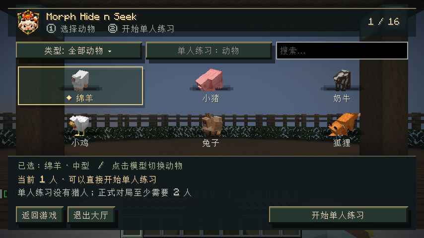
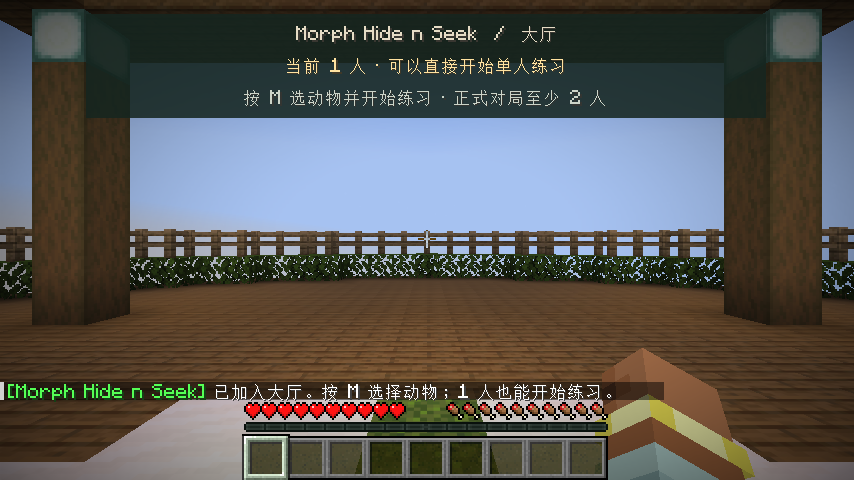
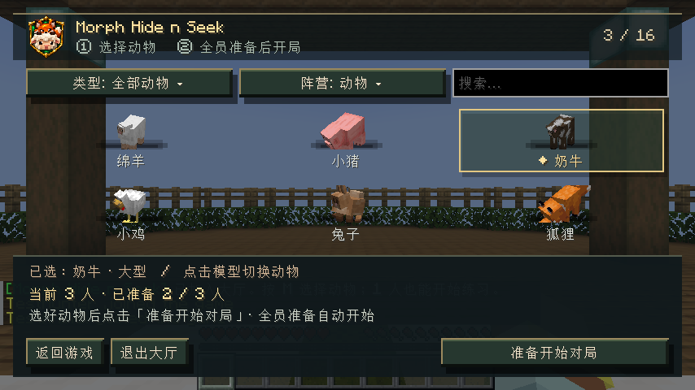

# Morph Hide n Seek · 0.4.4 大厅引导

## 界面变化

- 主菜单入口、大厅、HUD、聊天前缀、按键分类和模组列表统一显示 **Morph Hide n Seek**。
- 只有 1 人时，主操作为 **开始单人练习**，不再显示会让人一直等待的多人准备按钮。
- 单人练习明确说明没有猎人，可以体验动物变身和地图；正式对局至少需要 2 人。
- 单人模式的阵营栏明确显示“单人练习：动物”；多人时才提供阵营偏好选择。
- 多人大厅显示总人数与已准备人数，例如 **当前 3 人 · 已准备 2 / 3 人**；全员准备后自动开始。
- 大厅 HUD 不再显示 `00:00`，直接显示人数要求和开局操作；按键提示读取实际绑定的菜单键。
- 菜单保留六种 3D 动物和下拉筛选，说明区提高对比度，避免聊天文字干扰。
- 练习中的 HUD 明确标注“单人练习、无猎人”，结束时显示“练习结束”。

旧专用存档的内部目录标识保留，更新后继续打开已有大厅；新存档显示名使用 Morph Hide n Seek。

## 验证

使用 `./gradlew build runClientGameTest` 启动真实 Minecraft 26.3 客户端和内置服务器：检查单人按钮、正式对局人数提示、三人局准备计数，并实际进入单人练习与多人对局。此前的动物移动速度、击杀淘汰、退出恢复与实体清理测试一并运行。

本轮截图和最终日志保存在 `testing/0.4.4/`。

2026-11-03 最终结果：完整构建与客户端游戏测试通过，9 项已有单元测试零失败。

[完整验证日志](testing/0.4.4/verification.log)。发布包 SHA-256：`5791451b5e1fd52b5e0af7d9bb69b43eb8b061aa1efd4e0191f4055f5ae56c0a`。
