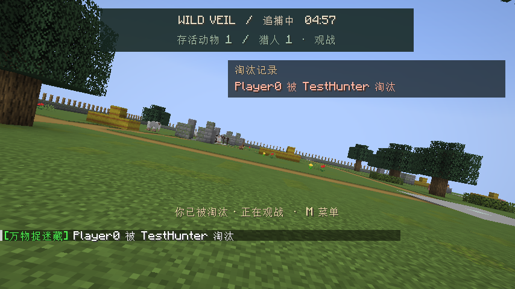
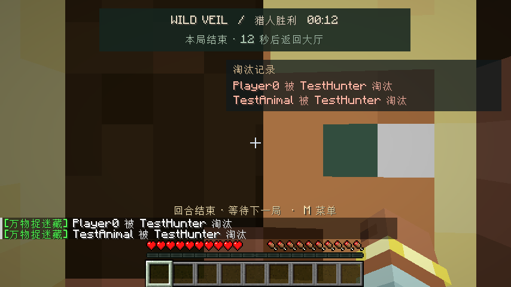

# 游戏内测试记录

最新 0.4.4 的名称与开局提示验证见 [大厅引导](LOBBY_UI.md)。0.4.3 的移动速度对照与完整复跑结果见 [动物移动速度](MOVEMENT.md)；以下保留 0.4.2 的 UI 截图与验证记录。

验证日期：2026-11-03。版本：Wild Veil 0.4.2 / Minecraft 26.3 / Fabric Loader 0.20.1 / Fabric API 0.165.0+26.3 / Java 25，macOS。

## 如何复跑

```sh
JAVA_HOME=/opt/homebrew/opt/openjdk@25/libexec/openjdk.jdk/Contents/Home ./gradlew build
JAVA_HOME=/opt/homebrew/opt/openjdk@25/libexec/openjdk.jdk/Contents/Home ./gradlew runClientGameTest
```

第二条命令会启动真实 Minecraft 客户端、渲染游戏界面并运行内置服务器。使用独立的 `build/run/clientGameTest` 目录，不操作正常游戏实例的存档。该测试目录会在下次测试前重建。

客户端测试入口：`src/gametest/java/dev/morphhide/test/LobbyGameTest.java`。战斗场景：同目录的 `CombatScenario.java`。测试模组只存在于开发测试环境，不打进发布 JAR。

## 已验证内容

| 范围 | 实际验证 |
| --- | --- |
| 规则与崩溃回归 | 5 项规则测试、4 项预览实体测试通过 |
| 主菜单入口 | 点击左下角徽章，自动创建专用存档并进入大厅 |
| 3D 图鉴 | 六种动物在真实客户端渲染；逐个选择并核对服务器同步结果 |
| 下拉与搜索 | 小型筛选、英文 rabbit 搜索、兔子选择、恢复全部动物、阵营偏好切换 |
| 练习 | 生成随机场地，进入独立维度，藏匿倒计时进入追捕阶段，回到大厅 |
| 重开 | 离开小游戏、关闭存档，再从主菜单入口打开同一存档并进入大厅 |
| 人数分配 | 一名客户端玩家加两名服务器测试玩家，全员准备后分配 1 猎人、2 动物 |
| 伤害 | 藏匿期间免伤；通过动物替身攻击路径执行原版铁剑伤害；非致命伤只扣血 |
| 淘汰 | 致命伤切换旁观模式，无复活界面；存活动物减少一名；只产生一条淘汰记录并保留猎人名字 |
| 胜负 | 最后一名动物受到致命伤后进入结算，胜方为猎人 |
| 恢复 | 离开后恢复原来的创造模式、物品栏第 5 格的 7 个钻石、20 点最大生命值及可见状态 |

服务器测试玩家使用原版 GameTestHelper 同类的 EmbeddedChannel 接入方式，执行正常玩家 tick，并处理传送确认和加载完成消息。铁剑攻击经过模组注册的攻击回调，再调用原版玩家攻击；没有直接调用淘汰函数来伪造结果。

这覆盖真实客户端渲染、内置服务器逻辑和状态同步；不代表已经完成两台电脑的真实网络联机、独立服务器或其他第三方模组组合的兼容性测试。

## 截图与日志

最终运行状态：`./gradlew build runClientGameTest` 完整通过，客户端与内置服务器正常退出；9 项 JUnit 测试零失败。

截图保留在 `docs/testing/`，原始运行截图位于 `build/run/clientGameTest/screenshots/`。

- `0000_01-title-entry.png`：主菜单入口。
- `0001_02-lobby-all-models.png`：六种 3D 动物。
- `0002_03-dropdown.png`：下拉筛选。
- `0009_10-elimination-hud.png`：实际淘汰通知和观战界面。
- `0010_11-hunters-win.png`：猎人获胜。

运行日志：`testing/verification.log`（包含构建、单元测试和真实客户端测试）。





发布 JAR：`morph-hide-and-seek-0.4.2.jar`。SHA-256：`37d9055287a222d680be4aff0be5d8554117ff289ad86bee9893c2687eebbec7`。
